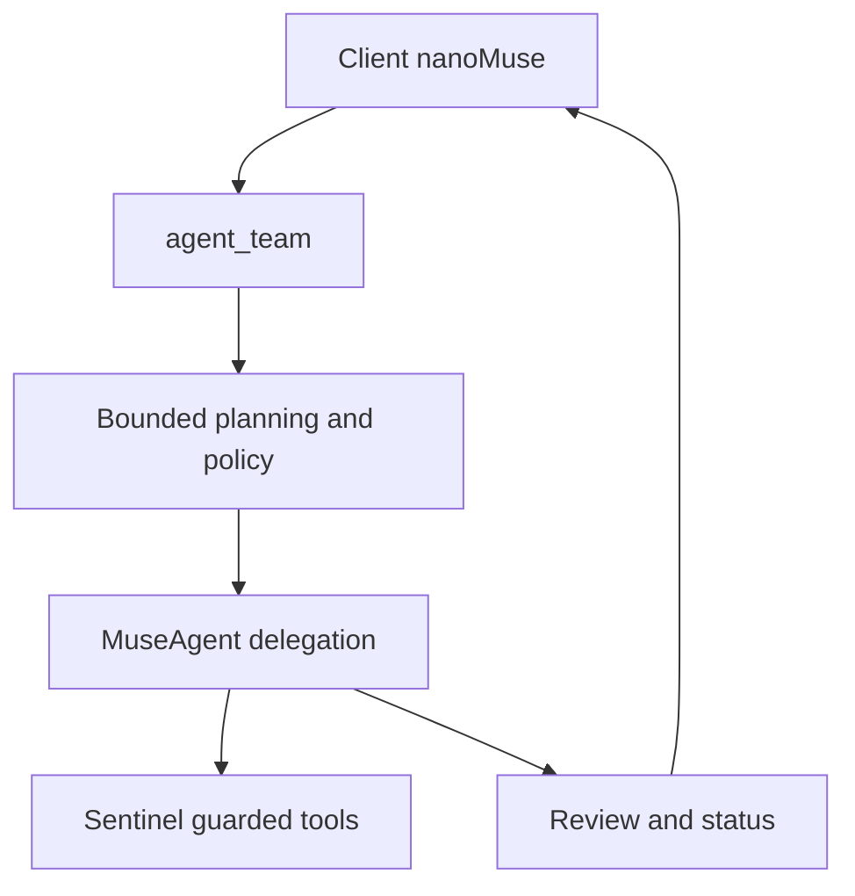
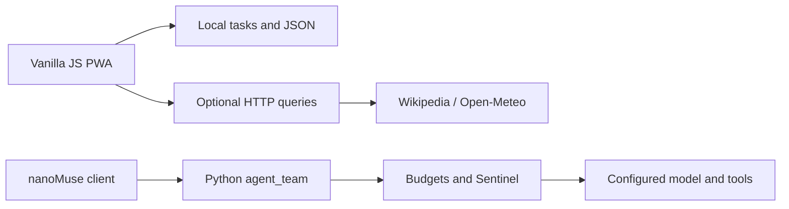

# NikoAssist — Studio Niko Design

**Bounded multi-agent orchestration for nanoMuse · Python runtime · Mobile integration**

[](LICENSE) [](nanomuse/nikoassist/) [](https://github.com/Nikoju1977/Nikoassist/actions/workflows/verify.yml)

[Installation](docs/INSTALLATION.md) · [Security](SECURITY.md) · [English overview](#english-overview) · [Portfolio](https://github.com/Nikoju1977)

[](web/) [](nanomuse/nikoassist/core.py)

**STUDIO NIKO DESIGN** · Build smart. Stay lightweight. Create without limits.

> [Insérer ici un GIF de démonstration / Insert demo GIF here]

**Pourquoi ce projet ?** Réutiliser le moteur nanoMuse plutôt que reconstruire une pile agentique complète : limiter les délégations, contrôler les outils, distinguer l'action réelle du résultat déclaré et faciliter l'intégration par un installateur reproductible.

## Fiabilisation du runtime — 25 novembre 2026

[Politique](https://github.com/Nikoju1977/Nikoassist/commit/7d8ce3b6adef907d3207ce276b046e2dfdabbf2d) · [Orchestrateur nanoMuse](https://github.com/Nikoju1977/Nikoassist/commit/8602aed25ecb176564bcabfca63be838d73a5b30) · [Runtime](https://github.com/Nikoju1977/Nikoassist/commit/08062facc9c6cf41d75299be8281fb1243f15700).

- Budget global de mission de 900 secondes par défaut (borné de 30 à 3 600 secondes), en plus des budgets existants. Un délai dépassé ne prouve pas l'annulation d'une action distante.
- Les appels de contrôle `terminate` et `agent_team` ne comptent plus comme preuve d'appel métier.
- Aucune délégation suivante après un rôle créateur/opérateur sans vérificateur indépendant ; résultat déclaré non vérifié, tâches restantes indiquées. La recherche et l'analyse restent délégables.
- Runtime auxiliaire : approbation explicite en mode create/act, absence de reprise automatique des rôles mutateurs, rejet des réponses non textuelles ou vides, validation des modes et limites. Ce runtime n'est pas une passerelle d'autorisation autonome : Sentinel reste indispensable.
- Retrait de `device__notify` de la liste des outils délégués autorisés par défaut.
- Tests de régression mis à jour dans trois fichiers. Les six empreintes source ont été relues ; [CI de la révision des tests](https://github.com/Nikoju1977/Nikoassist/actions/runs/45703939142) observée en attente. [Publication de la branche source](https://github.com/Nikoju1977/Nikoassist/actions/runs/45703897282) en échec à l'étape de mise à jour fast-forward ; cause exacte non établie. La syntaxe de l'overlay avait réussi dans ce run intermédiaire.

Aucun appel fournisseur réel, test physique ni nouvelle installation mobile revendiqué. La PWA reste distincte du runtime ; aucun raccordement réseau ni mémoire persistante supplémentaire ajouté. GPL et attributions d'origine inchangées.

## Vision & architecture

Une surcouche agentique maintenable, privilégiant la réutilisation du runtime existant, les budgets bornés et les autorisations explicites. Contrairement à une PWA autonome sans dépendances, NikoAssist repose sur Python et nanoMuse ; les modèles distants nécessitent un fournisseur configuré.

| Module | Rôle |
| --- | --- |
| [core.py](nanomuse/nikoassist/core.py) | Politique déterministe, rôles, budgets et liste blanche |
| [tool.py](nanomuse/nikoassist/tool.py) | Planification, délégation MuseAgent, synthèse |
| [install_nikoassist.py](scripts/install_nikoassist.py) | Installation atomique et simulation dry-run |
| [tests/](tests/) | Régressions hors ligne |
| [Mistral](docs/MISTRAL_VAULT.md) | Configuration du fournisseur et coffre natif |



### Deux surfaces d'exécution : runtime et PWA

| Surface | Fonctions | Limites |
| --- | --- | --- |
| Runtime Python (`main`, extension) | `agent_team`, délégation MuseAgent, budgets, Sentinel | Nécessite nanoMuse et un modèle configuré |
| `source-nikoassist` | Sources mobiles intégrées (voir branche liée ci-dessous) | Build et signature à vérifier séparément |
| [`web/`](web/README.md) | Calculatrice sans `eval`, tâches locales, sauvegarde JSON, dictée si compatible, PWA, Wikipédia et météo via proxy | Pas de connexion de cette PWA à `agent_team` ; requêtes externes pour Wikipédia/météo |



**Quickstart Web :** servir le dossier `web/` par `python -m http.server 8000 --directory web` puis ouvrir http://localhost:8000/. Les tâches et calculs sont locaux ; les routes Vercel nécessitent leur environnement serveur. [URL de déploiement documentée](https://nikoassist-pwa.vercel.app/) (disponibilité non vérifiée lors de cette mise à jour). Les sauvegardes JSON et le stockage local des tâches sont en clair. Les clés du runtime Python relèvent du coffre nanoMuse, pas de la PWA.

[Documentation Web](web/README.md) · [Audit de production](web/production-audit.cjs) · [Workflow de vérification](.github/workflows/verify.yml). La présence de ces fichiers ne prouve pas la réussite du dernier run.

> **Projet signature · 03/06 · AGENTS IA** — [Étude de projet : problème, choix techniques et limites](https://github.com/Nikoju1977/Nikoju1977/blob/main/SHOWCASE.md) · [Portfolio Studio Niko Design](https://github.com/Nikoju1977).


**Assistant IA multi-agents pour iOS, Android et ordinateurs**, construit à partir du projet libre [nanoMuse](https://github.com/nano-muse/nanoMuse).

## Deux branches sur ce GitHub

- **[source-nikoassist](https://github.com/Nikoju1977/Nikoassist/tree/source-nikoassist)** : **code source complet** nanoMuse, avec la marque NikoAssist sur les projets iOS/Android et l'outil multi-agents raccordé au moteur Python.
- **[main](https://github.com/Nikoju1977/Nikoassist)** : extension maintenable, installateur, tests et workflows d'intégration.

## Fonctionnalités clés implémentées

- Un orchestrateur **`agent_team`** avec jusqu'à **4 sous-agents spécialisés** : recherche, analyse, création, exécution.
- **Planification contrôlée** : filtrage des tâches, des rôles et des outils, sans escalade de privilèges depuis un résultat généré par IA.
- **Budgets d'exécution** : nombre d'agents, étapes, taille des messages et délais plafonnés.
- **Sentinel** : actions et outils sensibles soumis aux autorisations du moteur nanoMuse ; `create` et `act` classés sensibles avant la délégation.
- **Récupération prudente** : jamais de relance automatique des actions dont le résultat est incertain ; contrôle final et états vérifiables.
- **Installateur idempotent et atomique**, `--dry-run`, restauration en cas d'échec d'écriture.
- **tests de régression automatisés** dans `main` et workflow d'intégration sur le commit nanoMuse analysé.

## Installer

Consulter [le guide d'installation](docs/INSTALLATION.md). Depuis un clone de ce dépôt et un clone nanoMuse :

```bash
python scripts/install_nikoassist.py --target ../nanoMuse --dry-run
python scripts/install_nikoassist.py --target ../nanoMuse
python -m pip install 'pytest>=8,<10' 'pydantic>=2,<3' 'cryptography>=42,<48'
python -m pytest -q tests/
```

## Mistral AI + coffre de clés API

Le fournisseur **Mistral AI** est pris en charge via l'API compatible OpenAI de nanoMuse. NikoAssist fournit un assistant de configuration qui **saisit la clé sans l'afficher**, la place dans le coffre chiffré natif de nanoMuse et enregistre uniquement `{{vault:MISTRAL_API_KEY}}` dans la configuration.

```bash
python scripts/install_nikoassist.py --target ../nanoMuse
python scripts/configure_mistral.py --target ../nanoMuse
python scripts/configure_mistral.py --target ../nanoMuse --check
```

Modèle par défaut : `mistral-small-latest`. **La clé réelle est à créer dans votre propre compte Mistral Studio et à saisir localement ; elle ne doit pas être publiée, transmise dans le chat, ni intégrée aux applications mobiles.** La vérification `--check` est hors ligne : elle ne garantit pas l'authentification réseau.

Voir le [guide Mistral AI et coffre](docs/MISTRAL_VAULT.md).

## OpenMontage : production vidéo assistée par IA

NikoAssist dispose d'un outil optionnel `openmontage` qui découvre les pipelines
de [OpenMontage officiel](https://github.com/calesthio/OpenMontage), prépare un
brief de production et suit l'état des dossiers vidéo. La création du dossier
nécessite l'approbation Sentinel ; le moteur OpenMontage reste installé
séparément et sous **AGPL-3.0**.

```bash
# Sur le serveur, après installation et revue du projet officiel :
export NIKOASSIST_OPENMONTAGE_ROOT=/opt/OpenMontage
python scripts/install_nikoassist.py --target ../nanoMuse
# Redémarrer le backend nanoMuse.
```

**Portée actuelle :** connecteur et passation de projet, **pas** de rendu vidéo
automatique ni de génération sur le téléphone. Voir
[le guide OpenMontage](docs/OPENMONTAGE.md).

## Niveau de validation

**Vérifié :** tests de la politique, intégration automatisée de la surcouche dans un clone épinglé de nanoMuse, syntaxe Python et présence des points d'identité Android/iOS.

**Non encore vérifié :** application Android signée et installée sur des appareils réels, build iOS signé et tests sur iPhone, contrôle de l'OS sur toutes les versions, performances en production.

La couche multi-agents est disponible dans le **runtime Python associé** ; les applications mobiles peuvent lui déléguer du travail via les connexions de nanoMuse. Il ne s'agit pas encore d'une nouvelle interface native avec des agents exécutés chacun directement sur le téléphone. Les restrictions iOS continuent de s'appliquer.

**Objectif de fiabilité :** l'amélioration est mesurée par les tests et les builds. L'expression « dix fois plus fiable ou puissant » n'est pas un résultat démontré sans protocole de benchmark avant/après.

## Licence

Le code dérivé de nanoMuse et OpenMinis reste sous **GNU GPL-3.0-or-later**, avec les obligations de redistribution et les crédits d'origine. Voir [crédits et licences](LICENSE_NOTICE.md).

Adaptation, orchestration et documentation : **Studio Niko Design**. Projet indépendant, non affilié à nanoMuse ou Meta. Les auteurs d'origine et les obligations GPL sont indiqués dans [LICENSE_NOTICE.md](LICENSE_NOTICE.md).


## Builds Android et iOS (GitHub Actions)

Les chaînes de compilation natives sont publiées dans `main` :

- [Android — construire un APK de test arm64](.github/workflows/build-android.yml) : compile PRoot/Alpine puis `assembleDebug` et conserve l'APK comme artefact, **si le workflow réussit**.
- [iOS — compiler une application d'appareil non signée](.github/workflows/build-ios.yml) : compile LAME, FFmpeg et iSH sur macOS puis effectue un build Xcode ; le `.app` produit **n'est pas directement installable sur iPhone** sans signature Apple.

[Instructions de compilation et limites de distribution](docs/MOBILE_BUILDS.md). Aucun secret Mistral, certificat iOS ou keystore de distribution n'est inclus dans les builds.


## Roadmap & contribution

Propositions à valider (non terminées) :

- [ ] Vérifier l'intégration nanoMuse et les limites d'autorisation sur la révision courante.
- [ ] Reproduire les tests de la PWA, de la restauration JSON et de l'audit HTTP.
- [ ] Vérifier les builds Android/iOS et les tests sur appareils physiques.
- [ ] Concevoir une passerelle PWA vers runtime Python avec authentification et contrôle Sentinel explicites.

**Première contribution / `good first issue` (label proposé, existence non vérifiée) :** Ajouter un test de régression de la politique de délégation, ou documenter un défaut reproductible de restauration JSON.

[Issues](https://github.com/Nikoju1977/Nikoassist/issues) · [Historique des commits](https://github.com/Nikoju1977/Nikoassist/commits/main/)

## English overview

NikoAssist extends nanoMuse with an `agent_team` tool, bounded planning and delegation, role-based tool filtering and Sentinel-controlled actions. The policy permits up to four sub-agents, subject to execution budgets. Mistral configuration uses nanoMuse's native encrypted vault. The optional OpenMontage connector prepares briefs and tracks projects; it does not itself render video. Native mobile builds and device-level reliability require separate verification. The agents execute in the connected Python runtime, not as independent native agents on each phone.

Installation: follow [INSTALLATION.md](docs/INSTALLATION.md) using the pinned upstream revision. For a reproducible offline test, run the commands in that guide. The CI badge reports workflow state, not device certification. No tests were rerun for this documentation update.

The separate Vanilla JS PWA includes local tasks, backup/restore and arithmetic; Wikipedia and weather use server routes. It is not connected to the Python agent_team runtime. Contributions to GPL-covered code must preserve GPL rights, corresponding source and upstream attribution. Suggested first issue: a focused policy or task-restore regression.

## Contribuer / Contributing

Open an issue describing a reproducible problem, environment and expected behavior. Keep changes focused, add regression tests, and preserve the original license and attribution. Never attach credentials or private logs. See [SECURITY.md](SECURITY.md) for security matters and [LICENSE_NOTICE.md](LICENSE_NOTICE.md) for upstream credits.

**Studio Niko Design** · Evidence-driven agent orchestration.
